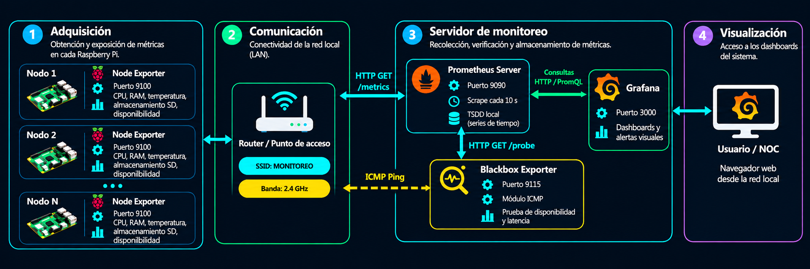

<p align="center">
  
</p>

<p align="center">
  <strong>Sistema de Monitoreo Centralizado de Salud para Clústeres de Raspberry Pi en Redes LAN</strong>
</p>

## 📝 Descripción

<p align="justify">
Las Raspberry Pi se han consolidado como plataformas de prototipado de bajo costo y amplia versatilidad, utilizadas en aplicaciones de Internet de las Cosas (IoT), automatización, agricultura, salud, telecomunicaciones y sistemas de monitoreo industrial. Su facilidad de integración con sensores, periféricos y herramientas de desarrollo ha favorecido su uso en aplicaciones de computación en el borde.
</p>
<p align="justify">
Sin embargo, debido a sus recursos computacionales limitados, estos dispositivos pueden experimentar condiciones de estrés, como sobrecarga de CPU, uso elevado de memoria y altas temperaturas. Estas condiciones pueden ocasionar degradación del rendimiento, aumento de los tiempos de respuesta e interrupciones en el funcionamiento del sistema.
</p>
<p align="justify">
Para mitigar estas condiciones, se propone un sistema de monitoreo local y centralizado para clústeres de Raspberry Pi conectadas a una red LAN, que permita supervisar el estado de los dispositivos mediante la recolección de métricas como utilización de CPU, uso de memoria RAM, temperatura de CPU, ocupación del almacenamiento en tarjeta SD y disponibilidad de los nodos en la red, facilitando la detección temprana de anomalías y posibles fallas.
</p>

### 📊 Variables monitoreadas

🖥️ **CPU** · 🧠 **RAM** · 🌡️ **temperatura de CPU** · 💾 **almacenamiento** · 📶 **disponibilidad** 


## 🧰 Especificaciones de hardware

| Componente | Descripción | 
|---|---|
| Nodos monitoreados | Raspberry Pi 3B+| 
| Servidor central | PC | 
| Infraestructura de red | Router o punto de acceso, Ethernet o Wi-Fi | 


## 💻 Especificaciones de software

| Componente | Ubicación | 
|---|---|
| Node Exporter | Raspberry Pi; servicio `systemd` | 
| Prometheus | Servidor central; contenedor Docker |
| Blackbox Exporter | Servidor central; contenedor Docker | 
| Grafana| Servidor central; contenedor Docker | 
| Docker Compose| Servidor central | 


## 🏗️ Diagrama de bloques

<p align="center">
  <a href="diagrama_bloques.png">
    
  </a>
</p>

## 🔄 Funcionamiento del sistema

1. 🍓 **Adquisición:** Node Exporter obtiene y expone las métricas de utilización de CPU, uso de memoria RAM, temperatura de CPU (si está disponible) y ocupación del almacenamiento SD de cada Raspberry Pi mediante HTTP (puerto `9100`).
2. 📡 **Comunicación:** el router o punto de acceso conecta las Raspberry Pi y el PC servidor a la red local `MONITOREO` (Wi-Fi de 2.4 GHz), permitiendo las consultas HTTP sobre TCP/IP y las pruebas de disponibilidad mediante ICMP.
3. 🖥️ **Servidor de monitoreo (PC):**
   - **Recolección:** Prometheus consulta las métricas cada 10 segundos mediante HTTP (scrape, modelo pull).
   - **Disponibilidad:** Prometheus solicita sondas a Blackbox Exporter, que comprueba mediante ICMP (*ping*) si cada nodo es accesible.
   - **Almacenamiento:** Prometheus conserva las métricas y los resultados de las sondas en una base de datos de series temporales (TSDB) local.
4. 📊 **Visualización:** Grafana consulta Prometheus mediante PromQL y presenta las métricas, los estados de disponibilidad y las alertas en un dashboard accesible desde un navegador conectado a la misma LAN. Las celdas del dashboard utilizan un código de colores según umbrales: 🟢 verde para funcionamiento normal, 🟡 amarillo para advertencia y 🔴 rojo para condiciones críticas.

### 🚦 Umbrales de visualización

| Variable | 🟢 Normal | 🟡 Advertencia | 🔴 Crítico |
|---|---|---|---|
| **Disponibilidad (ICMP)** | El nodo responde | 1 paquete perdido | Sin respuesta durante más de 15 s |
| **Utilización de CPU** | ≤ 70 % | > 70 % y ≤ 90 % | > 90 % |
| **Uso de memoria RAM** | ≤ 75 % | > 75 % y ≤ 90 % | > 90 % |
| **Temperatura de CPU** | ≤ 60 °C | > 60 °C y ≤ 75 °C | > 75 °C |
| **Ocupación del almacenamiento SD** | ≤ 80 % | > 80 % y ≤ 90 % | > 90 % |


## 📁 Estructura del proyecto

Los archivos de configuración de los nodos se organizan de la siguiente manera:

```text
RPI_monitor-/
├── README.md                     # Documentación general
├── setup_node_exporter.sh        # Instalación y verificación de Node Exporter en cada Raspberry Pi
└── prometheus/
    └── targets/
        ├── nodes.yml             # Direcciones IP y puerto 9100 para recolectar métricas
        └── nodes_ping.yml        # Direcciones IP para verificar disponibilidad mediante ICMP
```

- **`setup_node_exporter.sh`:** se ejecuta en cada Raspberry Pi; instala `prometheus-node-exporter`, habilita el servicio y muestra la IP detectada.
- **`nodes.yml`:** define los nodos que Prometheus consulta mediante HTTP en el puerto `9100`.
- **`nodes_ping.yml`:** define los nodos que Blackbox Exporter comprueba mediante sondas ICMP.

## ⚙️ Instalación y verificación básica

### 🍓 1. Instalación de Node Exporter

En cada nodo Raspberry Pi, se requiere una conexión de red con acceso a Internet para descargar e instalar Node Exporter desde los repositorios oficiales del sistema operativo:

```bash
sudo apt update
sudo apt install -y prometheus-node-exporter
```

Una vez instalado el paquete, se transfiere el archivo `setup_node_exporter.sh` a cada Raspberry Pi

### 📡 2. Conexión a la red LAN y activación del servicio

En cada Raspberry Pi, se configura la conexión a la red Wi-Fi local `MONITOREO` (banda de 2.4 GHz, sin acceso a Internet):

```bash
sudo raspi-config nonint do_wifi_ssid_passphrase \
  "MONITOREO" "<CLAVE_WIFI>"
sudo reboot
```
luego, desde la ubicación del archivo `setup_node_exporter.sh` se ejecuta:

```bash
chmod +x setup_node_exporter.sh
./setup_node_exporter.sh
```

El script instala `prometheus-node-exporter`, lo habilita como servicio `systemd` para su inicio automático, detecta la dirección IP del nodo y consulta las métricas de temperatura disponibles.


### 🖥️ 3. Configuración de nodos en Prometheus

En el PC (servidor central), se registran las direcciones IP en los archivos ubicados en `prometheus/targets/`.

**`nodes.yml` — Recolección de métricas HTTP (puerto 9100):**

```yaml
- targets:
    - "192.168.1.41:9100"
  labels:
    nodo: "raspberry-01"
    ip: "192.168.1.41"

- targets:
    - "192.168.1.36:9100"
  labels:
    nodo: "raspberry-02"
    ip: "192.168.1.36"
```

**`nodes_ping.yml` — Verificación de disponibilidad ICMP :**

```yaml
- targets:
    - "192.168.1.41"
  labels:
    nodo: "raspberry-01"
    ip: "192.168.1.41"

- targets:
    - "192.168.1.36"
  labels:
    nodo: "raspberry-02"
    ip: "192.168.1.36"
```

Se agrega un bloque por cada Raspberry Pi, con un identificador `nodo` único y las mismas direcciones IP en ambos archivos. 


## Plan de pruebas

1. **Configuración:** instalación de Node Exporter y verificación de la IP de cada nodo.
2. **Comunicación:** comprobación de conectividad ICMP y acceso HTTP desde el servidor central.
3. **Recolección:** validación de métricas recibidas en Prometheus y sondas de Blackbox Exporter.
4. **Visualización:** comprobación de dashboards, umbrales y reglas de alerta en Grafana.
5. **Plan de caos:** ejecución de pruebas controladas de estrés de recursos (CPU, RAM y almacenamiento), detención del servicio Node Exporter y pérdida de conectividad.
6. **Persistencia:** consulta de datos históricos.


